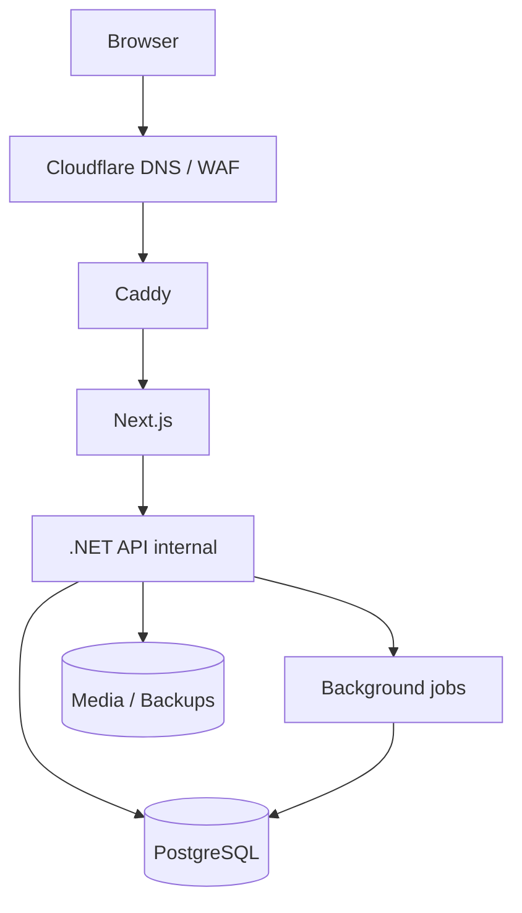

# RIGX Dar — Architecture

**Status:** Current state (audited 15 Nov 2026) + target architecture.
**Scope:** Shape, modules, data, API, frontend, deployment, decisions.

---

## 1. Shape of the System

### Current (legacy)

```
frontend/             React 19 + Vite SPA, custom CSS, framer-motion
backend/DarEltahfeez.Api  ASP.NET Core 10 minimal API, raw Npgsql, 3 giant endpoint files
desktop-host/         WPF + WebView2 shell
database/*.sql        12 SQL migrations (public schema)
tools/*.ps1           Windows launcher, local PostgreSQL, System Center
tests/                PowerShell runners + 2 C# regression projects
PostgreSQL 17         local runtime on 55432
```

### Target

```
apps/web              Next.js 16 (App Router, TypeScript strict)
packages/api-client   openapi.v1.json + generated types + typed fetch wrapper
src/Host/Dar.Api      ASP.NET Core 10 minimal API — composition root only
src/Modules/*         Feature modules — domain, use cases, persistence, endpoints
src/Common/*          Cross-cutting building blocks
tests/*               xUnit + Testcontainers (real PostgreSQL)
PostgreSQL 17         One database, public schema initially; module boundaries in code
```

**Legacy stays runnable until the replacement passes the same flows.** Then it is removed.

**Style: Modular Monolith.**

- One deployable API + one deployable web app.
- Strong module boundaries.
- Any module can be extracted later because modules never share tables.
- Microservices would add operations cost with no benefit at this scale.

**Public origin:** `https://darelemamhaf.rigxhardware.com`

- Next.js serves the UI.
- `/api/*` is proxied internally to the .NET API.
- The API is not exposed on a public subdomain in MVP.
- PostgreSQL is not exposed publicly.

---

## 2. Module Map

| Module | Owns | Current status |
|---|---|---|
| **Identity** | users, sessions, roles/permissions, email OTP + Google, profile, device alerts | legacy: password login, flat permissions |
| **Secretariat** | students, guardians, teachers, documents, enrollment/withdrawal | legacy: exists, guardian inline |
| **Academic** | groups/levels, schedules, holidays, conflict detection | legacy: circles + schedule slots |
| **Attendance** | student attendance, teacher attendance, approvals, edits, make-up sessions | legacy: exists, no approval workflow |
| **Payroll** | teacher rates, session pay, payroll runs, payslips, advances, deductions, adjustments | partial: on-the-fly pay, no runs/lock |
| **Billing** | fee plans, charges, discounts, payments, allocations, receipts, arrears, refunds | partial: charges/payments, no receipt sequence/discounts |
| **Treasury** | accounts, expenses, transfers, reconciliation, journal entries, period close | partial: expenses only, no accounts/ledger |
| **Reporting** | read models, reports, exports, dashboard KPIs | legacy: 6 PDF reports + saved snapshots |
| **Notifications** | email outbox, absence alerts, payment reminders, WhatsApp links | missing |
| **Auditing** | security events, business audit log, restore allowlist | legacy: audit/trash, mutable audit |
| **System** | settings, backups, export, health, trash, data reset | legacy: settings/backups/export |

**Rule:** a module owns its tables. One `public` schema initially; module boundaries are enforced in code. No cross-module table access. Cross-module communication goes through `Contracts`.

---

## 3. Inside a Module

```
src/Modules/Payroll/
  Domain/          entities, value objects, status rules (no Npgsql, no HTTP)
  Features/        one folder per use case:
    GeneratePayroll/
      GeneratePayrollRequest.cs
      GeneratePayrollHandler.cs
      GeneratePayrollValidator.cs
      GeneratePayrollEndpoint.cs
  Persistence/     Npgsql/Dapper repositories, SQL, migrations (public schema initially)
  Contracts/       public DTOs + interfaces other modules may call
  PayrollModule.cs DI registration + endpoint mapping
```

Rules:

- **Vertical slices.** A use case is found in one folder, not spread across a 1,400-line service.
- Controllers/endpoints are thin.
- Domain has no Npgsql/Dapper, no HTTP, no ASP.NET dependencies.
- Other modules talk through `Contracts` only.
- Endpoints live in the module, not in Host.
- Host only composes: `AddPayrollModule()`, `MapPayrollEndpoints()`.
- No cross-module repository calls.
- No shared tables.

---

## 4. Cross-Cutting

| Concern | Mechanism |
|---|---|
| **Errors** | `Common.Domain.AppException` (status + message + field errors). `ProblemDetailsExceptionHandler` maps once globally. Endpoints don't try/catch business errors. |
| **Validation** | FluentValidation per request, run by one endpoint filter. |
| **Authorization** | permission constants + `RequirePermission(...)` endpoint filter. Resource policies for row-level scoping. |
| **Audit log** | Explicit audit in the use case/repository, written in the same transaction. Before/after scalar fields. Append-only DB trigger. Secrets masked. |
| **Soft delete / Trash** | Soft delete for master data. **Financial records are never purged**; corrections via reversal/archive. |
| **Concurrency** | `row_version` token. Conflict → `409`. |
| **Time** | `TimeProvider` everywhere. No `DateTime.UtcNow` direct. Business dates use Africa/Cairo. |
| **Paging/filtering** | `PagedResult<T> { items, page, pageSize, total }`. Max page size 100. |
| **Background work** | hosted job runner (backups, reminders, reservation/charge jobs, outbox). |
| **Email** | transactional outbox → sender job with retries. |
| **Media** | storage abstraction (local volume now, S3-compatible later). |
| **Logging** | Serilog structured logs + correlation id. |
| **Idempotency** | `Idempotency-Key` table for financial POSTs. |

---

## 5. Data

### 5.1 Database

- PostgreSQL 17+.
- One database, **one `public` schema initially**; module boundaries are enforced in code.
- **Npgsql + Dapper** repositories, not EF Core. The existing SQL is the proven behavior; a full EF Core rewrite adds risk without business value.
- SQL migrations remain the source of truth.
- `DatabaseMigrator` is the single ordered list, with checksums and an advisory lock.
- Run with `dotnet run --project src/Host/Dar.Api -- --migrate`.
- Do **not** auto-apply migrations in Production.

### 5.2 Conventions

- Money: `numeric(14,2)` EGP. Never `float`.
- Dates: `timestamptz` UTC; business display Africa/Cairo.
- Statuses: enums/smart constants in Domain, stored as strings.
- IDs: UUIDv7 or bigint identity + public code. Decide per table.
- `created_at`, `updated_at`, `row_version` where applicable.
- Soft delete for master data; financial records immutable.

### 5.3 Integrity

- Unique attendance per `(session_id, student_id)`.
- Unique teacher attendance per `(session_id, teacher_id, role)`.
- Partial unique active enrollment per `(student_id, group_id)`.
- `EXCLUDE USING gist` to prevent overlapping teacher rate ranges.
- Check constraints for amounts.
- Payment allocation cannot exceed payment or charge.
- Journal lines must balance (debit = credit).
- Document sequences atomic and gap-free.

### 5.4 Transactions

- Financial operations inside one transaction.
- `Serializable`/`RepeatableRead` + retry for payroll and allocations.
- `SELECT ... FOR UPDATE` on charge/account rows.
- No side effects outside the transaction; use Outbox.
- `statement_timeout`, `idle_in_transaction_session_timeout`.

### 5.5 Migrations

- Expand/contract.
- No destructive `DROP` in production without backup.
- Test on staging.
- Backup before sensitive migration.

### 5.6 Roles

| Role | Permissions |
|---|---|
| `app_rw` | DML on operational tables, no DDL |
| `app_migrator` | DDL/migrations only |
| `backup` | read for backups |
| `readonly` | reporting/analysis |

- No superuser for the app.
- `REVOKE CREATE ON SCHEMA public FROM PUBLIC`.
- `scram-sha-256`.
- No public 5432.

### 5.7 Backups

- `pg_dump -Fc` daily.
- WAL archiving / `pgBackRest` if possible.
- Encrypted offsite copy.
- Retention: 7 daily, 4 weekly, 12 monthly.
- Monthly restore drill.
- RPO 24h minimum, RTO 4h.

---

## 6. API

### 6.1 Shape

- REST under `/api/v1`.
- Admin under `/api/v1/admin`.
- OpenAPI 3.1 generated from code.
- `packages/api-client/openapi.v1.json` committed.
- Contract test fails when code and file differ.
- TypeScript types generated from the contract (`openapi-typescript`).
- Typed fetch wrapper (`openapi-fetch`), no hand-written duplicate types.

### 6.2 Errors

RFC 9457 ProblemDetails for every failure:

```json
{
  "type": "https://darelemamhaf.rigxhardware.com/errors/insufficient-balance",
  "title": "الرصيد غير كافٍ",
  "status": 422,
  "detail": "لا يمكن تخصيص 500 جنيه على استحقاق قيمته 300 جنيه.",
  "instance": "/api/v1/payments",
  "requestId": "req_01J..."
}
```

- No stack traces in production.
- `requestId` in every response.
- Empty-body 401/403/404/429 mapped globally.

### 6.3 Conventions

- Plural resources: `/students`, `/teachers`, `/payroll-runs`.
- Actions: `POST /payroll-runs/{id}/approve`.
- Pagination: `?page=1&pageSize=25`.
- Filters: explicit query params, validated.
- Sorting: `?sort=createdAt:desc`.
- Idempotency: `Idempotency-Key`.
- Concurrency: `row_version` / `If-Match`.
- No mass assignment; explicit DTOs.
- Public DTOs never expose cost, private data, or passwords.

### 6.4 Auth

- **Email OTP + Google only** — no passwords, no SMS.
- OTP: 6 digits, 5 minutes, 5 attempts, single use, encrypted at rest.
- Google: ID-token flow; validate signature, issuer, audience, lifetime.
- Cookie sessions on the web origin.
- `HttpOnly`, `Secure`, `SameSite=Lax`, `__Host-`.
- CSRF token for unsafe methods.
- Server-side ticket store + revocation.
- Same-origin `/api` proxy; no CORS.
- API docs disabled or protected in production.
- Permission on every admin endpoint.
- Step-up email code for destructive actions.

### 6.5 Background Jobs

| Job | Purpose |
|---|---|
| `BillingChargeJob` | monthly charges, idempotent |
| `PayrollDraftJob` | draft payroll after period close |
| `NotificationJob` | absence/payment emails |
| `BackupJob` | daily backup |
| `CleanupJob` | expired sessions, idempotency keys, trash purge |
| `ReportJob` | heavy exports |

- Idempotent.
- Retries with backoff.
- Dead-letter.
- Distributed lock.

---

## 7. Frontend

### 7.1 Shape

```
apps/web/src/
  app/
    (auth)/login/
    (dashboard)/
      students/
      teachers/
      groups/
      attendance/
      payroll/
      billing/
      reports/
      settings/
    (print)/payslips/[id]/
    api/                # same-origin proxy / BFF only
  components/ui/        # shadcn/Radix
  features/             # feature folders
  lib/api/              # generated client
  lib/auth/             # session
  lib/format/           # money/date
```

### 7.2 Data Fetching

- Server Components fetch from the API through the same-origin proxy.
- Mutations via Server Actions or Route Handlers.
- TanStack Query for interactive screens, through the same origin.
- No tokens in the browser.
- `server-only` to prevent leaking server code.

### 7.3 Design System

- **Arabic + English** via `next-intl`; Arabic is the default.
- Tokens: colors, spacing, typography, radii, shadows.
- Font: IBM Plex Sans Arabic or Cairo.
- RTL: `dir="rtl"`, logical properties, mirrored directional icons.
- Components: Button, Input, Select, Dialog, Drawer, Table, Tabs, Badge, Toast, EmptyState, ErrorState, Skeleton.
- States: loading, empty, error, no-permission, long-text.

### 7.4 Motion

- Motion (`motion/react`).
- Page transitions, shared layout, stagger for small lists.
- Skeleton → content.
- Number ticker.
- Optimistic updates for attendance/payments.
- `prefers-reduced-motion`.
- No row-by-row table animation.
- Transform/opacity only.

### 7.5 Accessibility

- WCAG 2.2 AA.
- Keyboard navigation, focus visible, labels, error association.
- Contrast 4.5:1.
- Touch targets 44px.
- Screen reader checks.

### 7.6 Performance

- RSC + streaming + Suspense.
- Code splitting for charts/editors.
- Virtualization for large tables.
- Bundle analyzer.
- Budgets: LCP < 2.5s, INP < 200ms, CLS < 0.1.

### 7.7 Visual QA

- Playwright screenshots: 1440/1024/390.
- RTL + light/dark.
- Empty/loading/error/long text/0/1/1000 rows.
- Visual regression in CI.
- axe + Lighthouse.
- Print: A4 Arabic receipts/payslips.

---

## 8. Deployment

### 8.1 Topology



### 8.2 Domains

| Domain | Service |
|---|---|
| `darelemamhaf.rigxhardware.com` | Next.js UI + `/api` proxy |
| `api.darelemamhaf.rigxhardware.com` | optional later; not public in MVP |
| `staging.darelemamhaf.rigxhardware.com` | optional staging |

- Cloudflare DNS/WAF.
- SSL Full (strict).
- Origin firewall allows Cloudflare IPs only.
- HSTS + Always Use HTTPS.

### 8.3 Host

| Scenario | Specs |
|---|---|
| Minimum | 4 vCPU / 8GB / 100GB NVMe |
| Recommended (DB + worker same host) | 8 vCPU / 16GB / 160–240GB NVMe |
| Managed DB | 4 vCPU / 8GB for app |

- Ubuntu 24.04 LTS.
- Do not buy yet.

### 8.4 Docker Services

| Service | Notes |
|---|---|
| `caddy` | TLS + reverse proxy |
| `web` | Next.js standalone |
| `api` | .NET API |
| `worker` | background jobs (optional separate) |
| `postgres` | volume, no public port |
| `backup` | cron + pg_dump |
| `uptime-kuma` | monitoring (optional) |

- Non-root users.
- Healthchecks.
- Resource limits.
- Log rotation.
- Private network.

### 8.5 CI/CD

**PR:**
- build.
- unit + integration (Postgres service/Testcontainers).
- API contract diff.
- frontend typecheck/lint/build.
- dependency audit + secret scan.

**Main:**
- build images.
- push to GHCR.
- SSH deploy.
- run migrations.
- health check.
- rollback on failure.

### 8.6 Monitoring

- `/health/live`, `/health/ready`.
- Uptime Kuma.
- Serilog JSON logs + requestId.
- Telegram/email alerts.
- DB connections/slow queries/disk.

---

## 9. Decisions Log

| # | Decision | Why |
|---|---|---|
| 1 | .NET 10 + ASP.NET Core minimal API | owner choice; strong typing, long-term support |
| 2 | Next.js 16 frontend | RSC, routing, design system, animations |
| 3 | PostgreSQL 17 + **Npgsql/Dapper** | preserve proven SQL; relational money data; transactions/row locks |
| 4 | Modular monolith | one owner + AI engineers; low ops cost |
| 5 | One `public` schema initially | avoid risky table moves; module boundaries in code |
| 6 | Vertical slices | small files, one place per use case |
| 7 | Same-origin `/api` proxy | `__Host-` cookies, CSRF, no CORS, API hidden |
| 8 | Cookie sessions | HttpOnly, revocation, no tokens in browser |
| 9 | OpenAPI contract + generated TS client | frontend cannot drift from backend |
| 10 | No `.bat` | production web deployment, cross-platform |
| 11 | Tests inside the solution | xUnit/Testcontainers/Playwright; isolated DB; no test panel/routes |
| 12 | Double-entry ledger | financial integrity and reconciliation |
| 13 | Soft delete + audit | no history loss, accountability |
| 14 | Reports HTML print + XLSX | reliable Arabic typography |
| 15 | Strangler migration | preserve working UI/business logic |
| 16 | Keep existing SQL/business rules | don't rewrite proven financial behavior blindly |
| 17 | Email OTP + Google | owner decision; temporary password fallback during migration |
| 18 | Remove WPF/WebView2/desktop | web-only product; `darelemamhaf.rigxhardware.com` |
| 19 | No purge of financial history | corrections via reversal/archive only |
| 20 | Arabic + English | next-intl; Arabic default |

---

## 10. Current State — Audited 15 Nov 2026

| Area | Current | Target |
|---|---|---|
| Backend | 1 API project, 11 C# files, 3 giant endpoint files | `src/Host/Dar.Api` + `src/Modules/*` + `src/Common/*` |
| Frontend | React 19 + Vite SPA, 874-line hook, Arabic only | Next.js 16 App Router + ar/en + BFF |
| Database | PostgreSQL 17, public schema, 12 migrations, 25 tables | Same DB; migration CLI + checksums; schema moves optional |
| Auth | username/password, PBKDF2, no rate limit/lockout | Email OTP + Google; temporary password fallback |
| Tests | 39 PowerShell scripts + Test Center + 2 C# regression projects | xUnit + Testcontainers + Playwright inside solution |
| Deployment | Windows/WPF/WebView2, local PostgreSQL 55432, `.bat`, Task Scheduler | Ubuntu 24.04 + Docker + Caddy + Cloudflare |
| `.bat` | 12 files | removed |
| Docs | old handoffs + 14 docs | new `docs/` structure |

**Legacy tables (25):**
`app_users`, `roles`, `permissions`, `role_permissions`, `user_roles`, `user_permissions`, `students`, `teachers`, `circles`, `circle_enrollments`, `monthly_charges`, `payments`, `student_notes`, `teacher_notes`, `circle_schedule_slots`, `teacher_attendance`, `student_attendance`, `advertising_expenses`, `operating_expenses`, `school_settings`, `audit_log`, `trash_items`, `system_backups`, `collection_reports`, `schema_migrations`.

**Note:** `roles`, `role_permissions`, and `user_roles` exist but are not used by the legacy API; it uses `user_permissions` directly.

**Intake result:** `docs/07-gap-audit.md` (P0/P1/P2 + evidence).
**Migration rule:** legacy stays runnable until replacement passes the same flows.

### New foundation (Phase 2.1) — started

```
Dar.slnx
src/Host/Dar.Api              minimal API host, health, OpenAPI, ProblemDetails, security headers
src/Common/Dar.Common         AppException, PagedResult, Money, PermissionCodes
src/Modules/Identity          Email OTP, Google ID token, password fallback, sessions, /me, logout, set email
src/Modules/Secretariat       students list/get/create, paged search, audit
tests/Dar.UnitTests           xUnit domain/identity tests (12 passing)
tests/Dar.IntegrationTests    WebApplicationFactory health tests (3 passing)
database/013_auth_email_otp.sql
```

- Build: 0 warnings, 0 errors.
- `Microsoft.OpenApi` pinned to `2.7.5` to remove the known high-severity advisory.
- Identity verified end-to-end on an isolated PostgreSQL container.
- No self-registration; admins provision emails. Password fallback is temporary.

---

## 11. Decisions & Open Questions

### Resolved

- **Auth:** Email OTP + Google، بدون كلمات مرور أو SMS.
- **Language:** Arabic + English.
- **DB:** PostgreSQL on the same server.
- **Tests:** projects inside the solution, not a separate app.
- **Scope:** administrative/financial only, not an LMS.

### Open

1. Correct times for the 3 conflicting schedule slots (`00:07/00:10/00:11`).
2. Mid-month pause billing policy: prorate by active days, full month, or manual.
3. Emails for existing users/teachers (needed for OTP/Google).
4. Email/WhatsApp provider.
5. Step-up scope.
6. Double-entry from day one?
7. Guardian/student portal in year one?
8. Launch priority: payroll, billing, or reports? — after audit.
9. More than one branch?
10. Legacy Excel/paper import?
