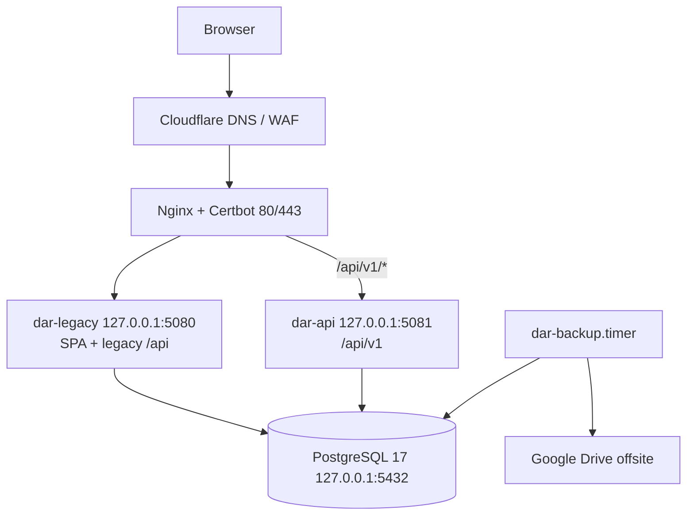

# RIGX Dar — Architecture

**Status:** Current state (22 Nov 2026 — Docs Reset) + target for the remaining migration.
**Scope:** Shape, modules, data, API, frontend, deployment, decisions.
**Source of truth:** `docs/00-current-state.md` — يحدد الحالة الآن. هذا الملف يشرح **الشكل والسبب**؛ وأي تعارض يُحسم لصالح `docs/00`.

---

## 1. Shape of the System

### Current

```
frontend/                 React 19 + Vite SPA — admin + teacher/supervisor PWA + homepage
backend/DarEltahfeez.Api  ASP.NET Core 10 minimal API — legacy domain/admin APIs on 5080
src/Host/Dar.Api          ASP.NET Core 10 minimal API — /api/v1 on 5081
src/Modules/*             Identity + Secretariat + Teaching
src/Common/*              AppException, PagedResult, Money, PermissionCodes
database/*.sql            23 SQL migrations (public schema), ledger = web_schema_migrations
tests/                    xUnit Unit/Integration (Testcontainers) + legacy regression/runners
PostgreSQL 17             host PostgreSQL on 127.0.0.1:5432
```

- الواجهة **React 19 + Vite + TypeScript** نهائيًا — قرار Next.js ملغي (ADR-0001). لا `apps/web` ولا BFF.
- الـSPA واحدة تخدم: الصفحة العامة `/`، لوحة الإدارة `/management`، بوابة المعلمة `/teacher`، ومساحة المشرفة `/supervisor`.
- Strangler migration: الـbackend القديم لا يزال مالكًا للدومين والإدارة والمالية، والـhost الجديد يملك `/api/v1` فقط (Identity + Secretariat + Teaching).
- كلا الـAPIs خلف نفس الـorigin عبر Nginx؛ الصلاحيات والجلسات مشتركة في قاعدة البيانات لكن بمصادقة منفصلة لكل host (انظر §6.4).

### Target (remaining migration — not a second rewrite)

```
src/Host/Dar.Api      composition root — health, OpenAPI, security headers, migrations
src/Modules/*         feature modules: domain, use cases, persistence, endpoints
src/Common/*          cross-cutting building blocks
tests/*               xUnit + Testcontainers; contract + Playwright later
PostgreSQL 17         one database, public schema; module boundaries in code
```

**Style: Modular Monolith.**

- One deployable web app + two deployable APIs during migration (legacy 5080, new 5081).
- Strong module boundaries; any module can be extracted later.
- Microservices would add operations cost with no benefit at this scale.

**Public origin:** `https://<deployment-host>`

- Nginx يخدم ملفات الـSPA الثابتة من الـlegacy API (5080 بعد `vite build`).
- `/api/v1/*` → `127.0.0.1:5081`؛ أي `/api/*` آخر → `127.0.0.1:5080`.
- PostgreSQL لا يُنشر للإنترنت. لا API subdomainعام.

---

## 2. Module Map

| Module | Owns | Current status (22 Nov 2026) |
|---|---|---|
| **Identity** | users, sessions, permissions, email OTP + Google, profile | legacy: password login + flat permissions؛ new `/api/v1`: password/sessions/change-password/OTP paths (Google deferred) |
| **Secretariat** | students, guardians, teachers, documents, enrollment/withdrawal | legacy: كامل (طلاب/معلمات/حلقات/التحاقات)؛ new: `/api/v1/students` list/get/create فقط |
| **Academic** | groups/levels, schedules, holidays, conflict detection | legacy: circles + schedule slots + منع تداخل المعلمة (migration 012) |
| **Attendance** | student/teacher attendance, approvals, edits, make-up sessions | legacy: تسجيل مباشر بدون workflow اعتماد؛ teacher sessions/roster في Teaching |
| **Payroll** | teacher rates, session pay, runs, payslips, adjustments | on-the-fly pay + **قفل شهري** (migration 022)؛ لا runs/payslips |
| **Billing** | fee plans, charges, discounts, payments, allocations, receipts, refunds | charges/payments + Charge Audit؛ **لا** receipt_no ولا خصومات ولا Reverse/Void بعد |
| **Treasury** | expenses, revenues, accounts, period close, journal entries | مصروفات + إعلانات فقط؛ الإيرادات وتقفيل الشهر في Phase 2.6؛ **لا** قيد مزدوج (ADR-0003) |
| **Teaching** | teacher sessions, roster, requests, earnings, supervisor read models | ✅ live — `src/Modules/Teaching` (`/api/v1/teacher/*`, `/api/v1/supervisor/*`, `/api/v1/notifications`) |
| **Reporting** | read models, reports, exports, dashboard KPIs | legacy: 6 تقارير PDF + snapshots؛ المالية محجوبة بدون `finance.read`+`reports.finance` |
| **Notifications** | persistent center, absence/payment alerts, WhatsApp links | ✅ live — notifications + read/resolve + admin pages + `wa.me` + `communication_log` |
| **Auditing** | security events, business audit log, restore allowlist | audit append-only (migration 015)؛ trash بصلاحيات لكل كيان؛ restore وصفي فقط |
| **System** | settings, backups, export, health, trash, data reset | legacy: settings/backups/export/health/trash؛ تأمين النسخ والـdeploy في Phase 2.1 |

**Rule:** a module owns its tables. One `public` schema initially; module boundaries are enforced in code. No cross-module table access. Cross-module communication goes through `Contracts`.

---

## 3. Inside a Module

```
src/Modules/Payroll/
  Domain/          entities, value objects, status rules (no Npgsql, no HTTP)
  Features/        one folder per use case:
    GeneratePayroll/
      GeneratePayrollRequest.cs
      GeneratePayrollHandler.cs
      GeneratePayrollValidator.cs
      GeneratePayrollEndpoint.cs
  Persistence/     Npgsql/Dapper repositories, SQL, migrations (public schema initially)
  Contracts/       public DTOs + interfaces other modules may call
  PayrollModule.cs DI registration + endpoint mapping
```

Rules:

- **Vertical slices.** A use case is found in one folder, not spread across a 1,400-line service.
- Controllers/endpoints are thin.
- Domain has no Npgsql/Dapper, no HTTP, no ASP.NET dependencies.
- Other modules talk through `Contracts` only.
- Endpoints live in the module, not in Host.
- Host only composes: `AddPayrollModule()`, `MapPayrollEndpoints()`.
- No cross-module repository calls.
- No shared tables.

---

## 4. Cross-Cutting

> الحالة: Identity/Teaching في `src/` تطبّق معظم ما يلي فعليًا؛ الـlegacy API يطبّق جزءًا منه فقط. ما لم يُذكر في `docs/00` فهو هدف للـmigration الكامل.

| Concern | Mechanism |
|---|---|
| **Errors** | `Common.Domain.AppException` (status + message + field errors) + `AppExceptionHandler` فعليًا في `src/Host/Dar.Api`؛ legacy ما زال يرجع رسائل محلية في بعض المسارات. |
| **Validation** | Validation يدوية/داخل handler في الوحدات الحالية؛ FluentValidation = هدف. |
| **Authorization** | permission constants + `RequireAuthorization("<permission>")` في `src/`؛ legacy يستخدم policies مشتقة من `Security.cs`. |
| **Audit log** | كتابة صريحة داخل المعاملة + أعمدة before/after؛ append-only DB trigger (migration 015). |
| **Soft delete / Trash** | soft delete للبيانات الأساسية؛ **السجلات المالية لا تُحذف نهائيًا**؛ الاستحقاق/الدفعة سيُلغيان بـReverse/Void (ADR-0005). |
| **Concurrency** | `row_version` هدف؛ الحالي يعتمد `FOR UPDATE` على صفوف المال. |
| **Time** | `Africa/Cairo` للأعمال؛ الوقت يُحسب في C# (لا يوجد `TimeProvider` شامل بعد). |
| **Paging/filtering** | `PagedResult<T>` موجود في `src/Common`؛ الـlegacy lists غير مُصفّحة (backlog). |
| **Background work** | `NotificationSyncService` (كل 6 ساعات) فقط الآن؛ jobs أخرى هدف. |
| **Email** | SMTP outbox هدف؛ OTP SMTP جاهز لكن ينتظر إعداد المزوّد. |
| **Media** | الصور/الإيصالات BYTEA داخل القاعدة حاليًا (لا object storage). |
| **Logging** | `DarFileLoggerProvider` في legacy + ILogger في `src/`؛ Serilog هدف. |
| **Idempotency** | `Idempotency-Key` هدف؛ الاعتماد الحالي على المعاملة + `FOR UPDATE`. |

---

## 5. Data

### 5.1 Database

- PostgreSQL 17+.
- One database, **one `public` schema initially**; module boundaries are enforced in code.
- **Npgsql + Dapper** repositories, not EF Core. The existing SQL is the proven behavior; a full EF Core rewrite adds risk without business value.
- SQL migrations are the ordered source of truth: **24 ملفًا (001→024)** في `database/` — الإنتاج على 23 حتى تطبيق `deploy/update.sh` القادم.
- `MigrationRunner` (`dotnet run --project src/Host/Dar.Api -- --migrate`) هو المسؤول الوحيد: checksums + advisory lock + تبنّي ledger القديم.
- `web_schema_migrations` هو الـledger الفعلي؛ `schema_migrations` القديم متوقف عند 16 ولن يُستخدم بعد الآن (إيقافه ضمن التنظيف — Phase 2.8).
- Do **not** auto-apply migrations in Production.

### 5.2 Conventions

- Money: `numeric(14,2)` EGP. Never `float`.
- Dates: `timestamptz` UTC; business display Africa/Cairo.
- Statuses: enums/smart constants in Domain, stored as strings.
- IDs: UUID (default) + public codes للأعمال.
- `created_at`, `updated_at`, `row_version` where applicable.
- Soft delete for master data; financial records immutable.

### 5.3 Integrity

- Unique attendance per `(session_id, student_id)`.
- Unique teacher attendance per `(session_id, teacher_id, role)`.
- Partial unique active enrollment per `(student_id, group_id)`.
- منع تداخل جدول المعلمة أسبوعيًا (migration 012 + preflight).
- Check constraints for amounts.
- Payment allocation cannot exceed payment or charge.
- Document sequences atomic and gap-free (مطلوب مع Reverse/Void في Phase 2.3).

### 5.4 Transactions

- Financial operations inside one transaction.
- `SELECT ... FOR UPDATE` on charge rows.
- لا side effects خارج المعاملة.

### 5.5 Migrations

- Expand/contract.
- No destructive `DROP` in production without backup.
- Backup قبل أي migration إنتاجية (إلزامي — يُؤتمت في `deploy/update.sh`).
- أي migration مطبّقة لا تُعدَّل (تغيير checksum يوقف الـrunner)؛ التصحيح = migration جديد.

### 5.6 Roles

| Role | Permissions |
|---|---|
| `app_rw` | DML on operational tables, no DDL |
| `app_migrator` | DDL/migrations only |
| `backup` | read for backups |
| `readonly` | reporting/analysis |

- No superuser for the app.
- `REVOKE CREATE ON SCHEMA public FROM PUBLIC`.
- `scram-sha-256`.
- No public 5432.
- ملاحظة: فصل الـDB roles لم يُنفّذ بالكامل على الـhost بعد (backlog).

### 5.7 Backups

- `pg_dump -Fc` يوميًا (systemd timer) + نسخة offsite مشفّرة (Google Drive) — ✅ live.
- الوضع الحالي: script واحد `deploy/scripts/dar-backup.sh` (dump + rclone + retention 30 يومًا).
- المطلوب في Phase 2.1: `manifest.json` + SHA-256 + healthcheck + تنبيه فشل + restore drill موثّق.
- RPO 24h minimum، RTO 4h.

---

## 6. API

### 6.1 Shape

- REST: `/api/v1/*` على الـhost الجديد (52 endpoint)، و`/api/*` القديمة (91 endpoint) للدومين والإدارة حتى استكمال الـmigration.
- OpenAPI 3.1 يُولَّد من `src/Host/Dar.Api` على `/api/openapi/v1.json` (غير منشور عبر Nginx).
- `packages/api-client/openapi.v1.json` مُلتزم لكنه **ناقص** (27 path مقابل 52 endpoint فعلي) و**غير مستخدم** في الواجهة.
- **لا يوجد contract test بعد** — إعادة التوليد + contract test + استخدام الـclient هي مرحلة Phase 2.5.
- حتى ذلك الحين: أنواع TypeScript المكتوبة يدويًا (`frontend/src/domain/types.ts` و`frontend/src/teacher/teacherTypes.ts`) هي المصدر، وأي تغيير endpoint يحدّثها في نفس التغيير.

### 6.2 Errors

RFC 9457 ProblemDetails for every failure:

```json
{
  "type": "https://<deployment-host>/errors/insufficient-balance",
  "title": "الرصيد غير كافٍ",
  "status": 422,
  "detail": "لا يمكن تخصيص 500 جنيه على استحقاق قيمته 300 جنيه.",
  "instance": "/api/v1/payments",
  "requestId": "req_01J..."
}
```

- No stack traces in production.
- `requestId` in every response.
- Empty-body 401/403/404/429 mapped globally.

### 6.3 Conventions

- Plural resources: `/students`, `/teachers`, `/payroll-runs`.
- Actions: `POST /payroll-runs/{id}/approve`.
- Pagination: `?page=1&pageSize=25`.
- Filters: explicit query params, validated.
- Sorting: `?sort=createdAt:desc`.
- Idempotency: `Idempotency-Key`.
- Concurrency: `row_version` / `If-Match`.
- No mass assignment; explicit DTOs.
- Public DTOs never expose cost, private data, or passwords.

### 6.4 Auth

- **المسار الحالي:** username/password (PBKDF2-SHA256, 210k iterations) + cookie sessions. لا SMS.
- Email OTP paths مُنفّذة في Identity module وتحتاج SMTP + pepper؛ **Google مؤجل**؛ password fallback يبقى حتى تُجمع إيميلات الحسابات.
- كوكيز منفصلة لكل host: `DarEltahfeez.Admin` (SameSite=Strict) للـlegacy — الـticket يحمل الهوية و`session_version` فقط والصلاحيات تُقرأ من `user_permissions` في كل طلب (ADR-0008)، و`dar_session` (SameSite=Lax) للـnew API. كلاهما `HttpOnly`. الـlegacy `Secure` يتبع scheme (`SameAsRequest`): Secure دائمًا خلف HTTPS الإنتاج (nginx يضيف `X-Forwarded-Proto: https`) ولا يظهر على HTTP staging؛ الـnew API لا يزال `Secure` خارج Development (راجع B10 في docs/03-security.md).
- Revocation: `session_version` bump عند تغيير كلمة المرور/إزالة صلاحية، ويُتحقق منه في الـhostين.
- CSRF: **لا يوجد token** — الحماية الحالية origin/referer guard على الطلبات غير الآمنة + SameSite + لا CORS.
- Rate limit: 10/دقيقة لكل IP على مسارات auth. **لا lockout لكل حساب بعد**.
- لا `__Host-` prefix بعد. Session lifetime: 8 ساعات + sliding (legacy).
- API docs disabled or protected in production.

### 6.5 Background Jobs

| Job | Status |
|---|---|
| `NotificationSyncService` | ✅ يعمل كل 6 ساعات — upsert لإشعارات الدفع المقيّدة بالـscope |
| `BillingChargeJob` | هدف — الشهر الحالي يدوي |
| `PayrollDraftJob` | هدف — لا runs بعد |
| `BackupJob` | ✅ خارج التطبيق: systemd timer + script |
| `CleanupJob` | هدف — جداول sessions/OTP بلا تنظيف دوري |
| `ReportJob` | هدف — التقارير عبر window.print الآن |

- Idempotent، retries، dead-letter، distributed lock = متطلبات التصميم للـjobs الجديدة.

---

## 7. Frontend

### 7.1 Shape (React 19 + Vite — final)

```
frontend/src/
  main.tsx              route switch: / → home، /teacher و /supervisor → TeacherApp، غير ذلك → admin
  App.tsx               admin shell (sidebar/topbar/theme/login gate + password dialog)
  SystemAdminView.tsx   لوحة النظام (backup/export/trash/audit/settings)
  home/                 الصفحة العامة
  pages/                صفحات الإدارة: dashboard, students, teachers, circles, schedule, payments,
                        users, system, notifications, requests
  application/          app state hooks + selectors (useDarApplication, useDarAuth, useDarDataLoaders)
  components/           shared UI + dialogs (ApplicationDialogs, ManagementReportBuilder, ...)
  domain/               types + defaults
  services/             apiClient + desktop bridges (desktop ميت على الويب — يُزال في التنظيف)
  system/               أدوات ثابتة للوحة النظام (constants, formatting)
  teacher/              بوابة المعلمة + مساحة المشرفة (TeacherApp, SupervisorWorkspace, teacherApi, ...)
  styles/               CSS tokens + styles لكل منطقة (12 ملف CSS)
```

- SPA واحدة تُبنى بـ`vite build` وتُخدَم من `wwwroot` الخاص بالـlegacy API؛ manifest + service worker للـPWA على `/teacher` و`/supervisor`.
- التوجيه يدوي حسب `window.location.pathname` في `main.tsx`؛ لا router library ولا i18n.
- الواجهة الإدارية تتكلم مع `/api/*` القديمة؛ بوابة المعلمة/المشرفة تتكلم مع `/api/v1/*` فقط.
- **لا Next.js، لا `apps/web`، لا Server Components، لا BFF** — القرار ملغي نهائيًا (ADR-0001). تطوير التصميم لاحقًا على نفس الواجهة.

### 7.2 Data Fetching

- `fetch` + `credentials: 'include'` + `cache: 'no-store'`، same-origin فقط؛ لا tokens في المتصفح.
- Wrappers مكتوبة يدويًا: `services/apiClient.ts` (admin) و`teacher/teacherApi.ts` (teacher/supervisor).
- React hooks عادية (`useState/useEffect`)؛ لا TanStack Query.
- Loading/empty/error/no-permission required على كل صفحة.

### 7.3 Design System

- CSS tokens في `frontend/src/styles/`؛ Font: Cairo؛ navy/teal + glass cards؛ dark/light عبر `data-theme`.
- **العربية فقط الآن** (RTL)؛ الإنجليزية مؤجلة (ADR-0004).
- Components: Button, Input, Select, Dialog/Sheet, Table (+ mobile cards), Tabs, Badge, Toast, EmptyState, ErrorState, Skeleton.
- States: loading, empty, error, no-permission, long-text.

### 7.4 Motion

- framer-motion.
- 150–250ms micro-interactions؛ transform/opacity فقط.
- `prefers-reduced-motion`.
- No row-by-row table animation.

### 7.5 Accessibility

- WCAG 2.2 AA.
- Keyboard navigation, focus visible, labels, error association.
- Contrast 4.5:1.
- Touch targets 44px (تم تعديل أهداف الموبايل في Phase 1.41).

### 7.6 Performance

- Route-level lazy loading: `TeacherApp` محمّل بـ`lazy()` مسبقًا.
- Bundle الحالي ~717 KB JS / ~200 KB gzip.
- Budgets: LCP < 2.5s, INP < 200ms, CLS < 0.1.
- **أولوية UI المعتمدة (22 Nov): تجاوب 100% للوحة الإدارة على الموبايل** — Phase 2.4؛ انظر `docs/audits/admin-mobile-responsive-audit.md`.

### 7.7 Visual QA

- مراجعة يدوية على 1440/1024/390 + أجهزة حقيقية.
- RTL + light/dark؛ empty/loading/error/long text/0/1/1000 rows.
- Playwright + visual regression = هدف: smoke في Phase 2.5، وE2E كامل في Phase 2.9.
- Print: A4 للتقارير والإيصالات عبر `window.print()`.

---

## 8. Deployment

### 8.1 Topology (live)



### 8.2 Domains

| Domain | Service |
|---|---|
| `<deployment-host>` | Nginx → SPA + APIs (live) |
| `api.` subdomain | غير مستخدم؛ الـAPIs داخلية فقط |
| `staging.` | غير مُنشأ بعد |

- Cloudflare DNS/WAF؛ SSL Full (strict)؛ Certbot DNS-01 عبر Cloudflare token.
- تقييد الـorigin على Cloudflare IPs: **غير منفَّذ** (ضمن سبرنت الأمان).

### 8.3 Host

- Contabo VPS 4: 4 vCPU / 8GB / 100GB، Ubuntu 24.04 LTS، TZ `Africa/Cairo`.
- UFW: 22/80/443؛ SSH keys only؛ fail2ban؛ unattended upgrades.
- Docker/Caddy stack **متقاعد** على هذا الـhost؛ الـvolumes محفوظة كنسخة rollback.

### 8.4 Services

| Service | Notes |
|---|---|
| `nginx` | TLS + reverse proxy + buffers (إصلاح 502) |
| `dar-legacy.service` | SPA + `/api/*` على 5080 |
| `dar-api.service` | `/api/v1/*` + health على 5081 |
| `postgresql` | 17 على 127.0.0.1:5432 |
| `dar-backup.timer` | dump يومي + offsite |
| `certbot.timer` | تجديد الشهادات |

- الخدمات تعمل بمستخدم `dar` (غير جذري)؛ الإعداد الحالي غير قابل لإعادة التنفيذ بالكامل من السكربتات — يُصلَح في Phase 2.1.

### 8.5 CI/CD

- GitHub Actions `ci.yml`: build legacy + `Dar.slnx`، migrations على PostgreSQL، frontend test/build، api-client typecheck، compose validation، وحساسية dependency/secret scans.
- **لا نشر آلي ولا rollback job**؛ أول تشغيل على GitHub لم يُتحقق منه بعد.
- تحديث الـhost يدوي حاليًا (`git pull` + publish + restart) — **ممنوع بدون backup + `--migrate`**؛ تُؤمَّن في Phase 2.1 عبر `deploy/preflight.sh` + `deploy/update.sh` + `deploy/rollback.sh`.
- لا registry/images على الـhost الحي (الـDocker stack متقاعد).

### 8.6 Monitoring

- `/health/live` و`/health/ready` على كلا الـAPIs (Nginx ينشر `/health/*` من legacy).
- Uptime/monitoring/alerting: غير مُنشأة بعد (Phase 2.x)؛ فشل النسخ يظهر عبر `systemctl --failed`.

---

## 9. Decisions Log

| # | Decision | Why |
|---|---|---|
| 1 | .NET 10 + ASP.NET Core minimal API | owner choice; strong typing, long-term support |
| 2 | ~~Next.js 16 frontend~~ → **ملغى** (استُبدل بـ#27) | RSC/SSR غير مطلوب لنظام إداري؛ Next.js لم يُبنَ أبدًا |
| 3 | PostgreSQL 17 + **Npgsql/Dapper** | preserve proven SQL; relational money data; transactions/row locks |
| 4 | Modular monolith | one owner + AI engineers; low ops cost |
| 5 | One `public` schema initially | avoid risky table moves; module boundaries in code |
| 6 | Vertical slices | small files, one place per use case |
| 7 | Same-origin Nginx proxy | cookies بلا CORS، والـAPIs داخلية |
| 8 | Cookie sessions | HttpOnly, revocation, no tokens in browser |
| 9 | OpenAPI contract + generated TS client | هدف Phase 2.5 — لم يُفعَّل بعد؛ الـclient غير مستخدم والمَلف ناقص |
| 10 | No `.bat` | production web deployment, cross-platform |
| 11 | Tests inside the solution | xUnit/Testcontainers; isolated DB; no test panel/routes |
| 12 | ~~Double-entry ledger from day one~~ → **مؤجل** (انظر #28) | المرحلة الحالية: treasury + إيرادات/مصروفات + تقفيل شهري بدون ledger |
| 13 | Soft delete + audit | no history loss, accountability |
| 14 | Reports HTML print + XLSX | reliable Arabic typography |
| 15 | Strangler migration | preserve working UI/business logic |
| 16 | Keep existing SQL/business rules | don't rewrite proven financial behavior blindly |
| 17 | Email OTP + Google | owner decision; temporary password fallback during migration |
| 18 | Remove WPF/WebView2/desktop | web-only product; `<deployment-host>` |
| 19 | No purge of financial history | corrections via Reverse/Void (انظر #30 وADR-0005) |
| 20 | ~~Arabic + English~~ → **العربية الآن، الإنجليزية مؤجلة** (انظر #29) | لم يُنفَّذ i18n؛ لا حاجة تشغيلية حاليًا |
| 21 | .NET is the final backend | owner decision; TypeScript/NestJS rejected to avoid a second rewrite |
| 22 | Google login deferred | temporary password + sessions is the current path |
| 23 | File size budget 200–400 lines | split every use case; legacy exceptions documented |
| 24 | One unified .NET backend; OpenAPI is the generated/stable boundary | contract stability + replaceable modules; no duplicated backend |
| 25 | UI sample gate | owner approves a visual sample before any UI implementation |
| 26 | Legacy split first, no behavior change | partial classes → feature files → modules; build after each slice |
| **27** | **React 19 + Vite + TypeScript نهائي؛ Next.js ملغي** | نظام إداري داخلي؛ الواجهة الحالية live ومُختبرة؛ إعادة كتابة Next.js بلا قيمة مقابل تكلفتها (ADR-0001) |
| **28** | **الخزنة الآن بدون قيد مزدوج** | نطاق Phase 2.6: خزنة + إيرادات + مصروفات + تقفيل شهري؛ القيد المزدوج مؤجل لمرحلة متقدمة (ADR-0003) |
| **29** | **الإنجليزية مؤجلة** | العربية فقط الآن؛ i18n في خطة مستقبلية دون التزام تاريخي (ADR-0004) |
| **30** | **Reverse/Void بدل الحذف المالي** | كل سجل مالي يبقى ظاهرًا؛ الإلغاء بإجراء عكسي + سبب إلزامي + Audit؛ يُستبدل نقل الاستحقاق للـtrash (ADR-0005) |

---

## 10. Current State — 22 Nov 2026

> التفاصيل الكاملة في `docs/00-current-state.md`؛ هذا ملخص معماري.

| Area | Current |
|---|---|
| Frontend | React 19 + Vite SPA واحدة (bundle ~717KB) — Home `/`، Admin `/management`، Teacher `/teacher`، Supervisor `/supervisor` |
| Backend (legacy) | `backend/DarEltahfeez.Api` — 33 ملف C#، **91 endpoint** على 5080، يخدم الـSPA + كل الدومين/الإدارة/المالية |
| Backend (new) | `src/` — 79 ملف C#، **52 endpoint** على 5081: Identity + Secretariat (students) + Teaching (teacher/supervisor/notifications) |
| Database | PostgreSQL 17 — **24 migration في المستودع** (001→024؛ الإنتاج 23 حتى النشر)؛ ledger `web_schema_migrations`؛ `schema_migrations` متوقف عند 16 |
| Auth | password + cookie sessions على الـhostين؛ OTP path جاهز، Google مؤجل؛ `session_version` revocation |
| Tests | 16 unit + 20 integration (Testcontainers) + 6 Vitest؛ لا Contract ولا Playwright/E2E |
| CI | موجود للمسارات الأساسية؛ لا deploy/rollback؛ أول run غير متحقق |
| Deployment | Ubuntu + Nginx + Certbot + systemd + PostgreSQL 17؛ Docker/Caddy متقاعد |
| Live | `https://<deployment-host>` — آخر commit متحقق `43cf810` |

**Legacy tables (25):**
`app_users`, `roles`, `permissions`, `role_permissions`, `user_roles`, `user_permissions`, `students`, `teachers`, `circles`, `circle_enrollments`, `monthly_charges`, `payments`, `student_notes`, `teacher_notes`, `circle_schedule_slots`, `teacher_attendance`, `student_attendance`, `advertising_expenses`, `operating_expenses`, `school_settings`, `audit_log`, `trash_items`, `system_backups`, `collection_reports`, `schema_migrations`.

**Note:** `roles`, `role_permissions`, `user_roles` موجودة لكن الـlegacy API يستخدم `user_permissions` مباشرة؛ role templates تُستخدم كقوالب seed فقط.

### New modules (live)

```
src/Host/Dar.Api              composition root, health, security headers, migration runner, notification sync
src/Common/Dar.Common         AppException, PagedResult, Money, PermissionCodes
src/Modules/Identity          password/sessions/change-password/OTP paths + set email + /me + logout
src/Modules/Secretariat       students list/get/create
src/Modules/Teaching          teacher today/sessions/roster/attendance/earnings/subscriptions/calendar/history/requests
                              + supervisor live/absences/unpaid/students/circles/teachers/attendance/scopes/requests
                              + notifications + WhatsApp communication
packages/api-client           OpenAPI spec (ناقص) + generated types + openapi-fetch (غير مستخدم)
tests/Dar.UnitTests           domain/identity unit tests (16 passing)
tests/Dar.IntegrationTests    WebApplicationFactory + Testcontainers (20 passing — health, same-origin, supervision)
```

- Build: 0 warnings / 0 errors.
- الاختبارات المالية ومسارات الـlegacy الكبيرة خارج CI حتى Phase 2.5.
- لا يوجد contract/E2E بعد.

---

## 11. Decisions & Open Questions

### Resolved

- **Frontend:** React 19 + Vite + TypeScript — نهائي (ADR-0001). Next.js ملغي.
- **Backend:** .NET 10 — نهائي؛ لا TypeScript backend.
- **DB:** PostgreSQL 17 على نفس السيرفر؛ `public` schema.
- **Auth (current):** password + sessions؛ OTP path مُنفّذ؛ Google مؤجل.
- **Language:** العربية فقط الآن؛ الإنجليزية مؤجلة (ADR-0004).
- **Scope:** إداري/مالي فقط، ليس LMS.
- **Financial:** agreed fee بلا pro-rata؛ أجر بالدقيقة بلا تقريب 5؛ لا حذف مالي — Reverse/Void (ADR-0002/0005).
- **Treasury:** الخزنة/الإيرادات/المصروفات/تقفيل الشهر الآن؛ القيد المزدوج مؤجل (ADR-0003).

### Open

1. المواعيد الثلاثة المتداخلة قديمًا (`00:07/00:10/00:11`) — تحتاج تحققًا إنتاجيًا موثقًا (Phase 2.2).
2. مزود البريد/واتساب (SMTP provider) — مطلوب لتفعيل OTP فعليًا.
3. مدة/شروط خطوة step-up والتوقيع.
4. أولوية الإيصالات المرقّمة / مسير الرواتب / خصومات وخطط رسوم (backlog — مؤجل 3.0+ بعد Phase 2.6).
5. بوابة ولي الأمر/الطالبة — خارج العام الأول.
6. أكثر من فرع؟
7. بيانات Excel/ورق قديمة تحتاج استيراد؟
